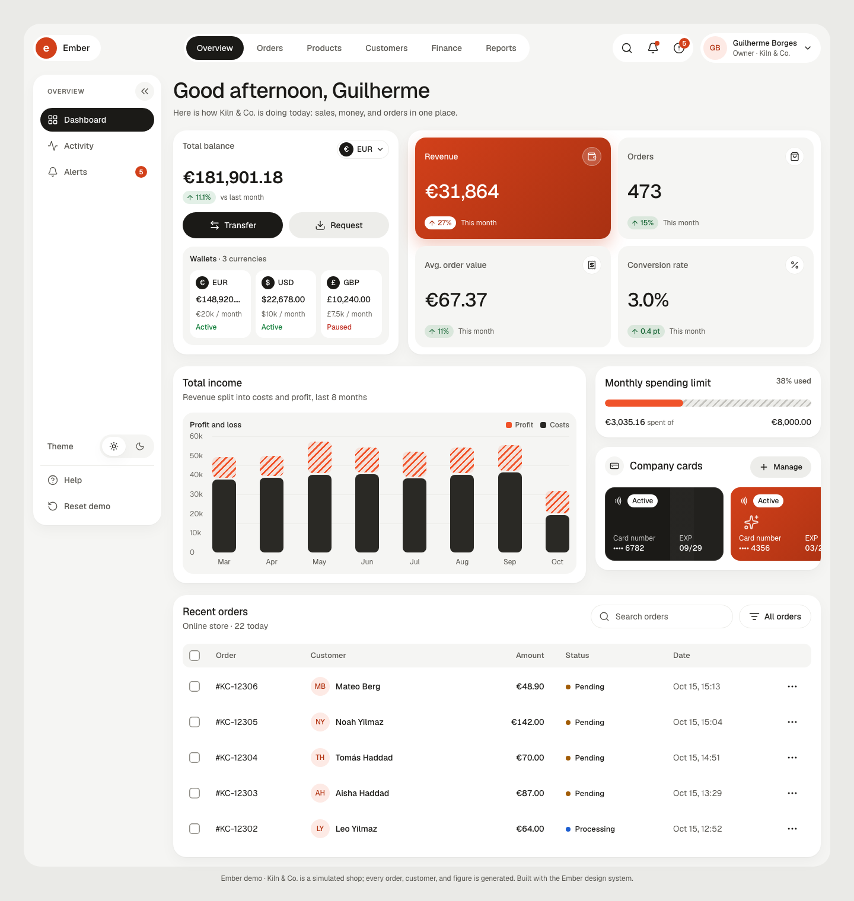
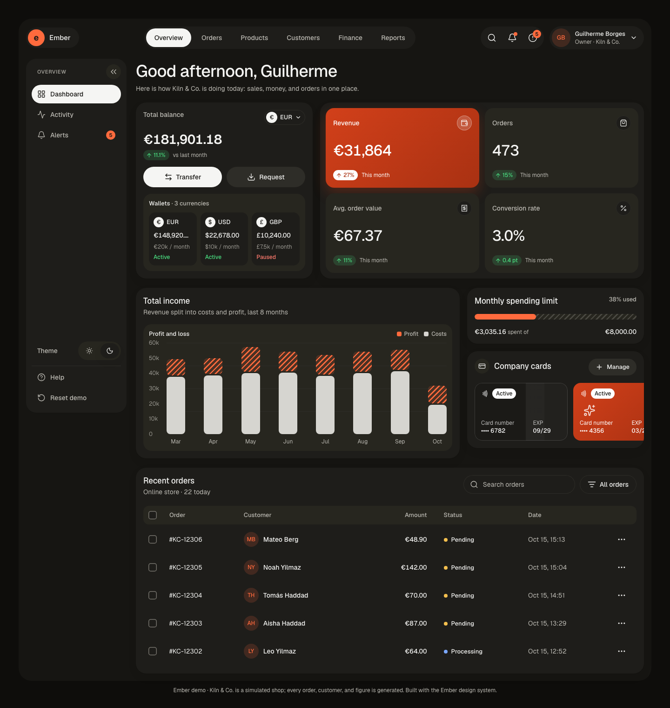
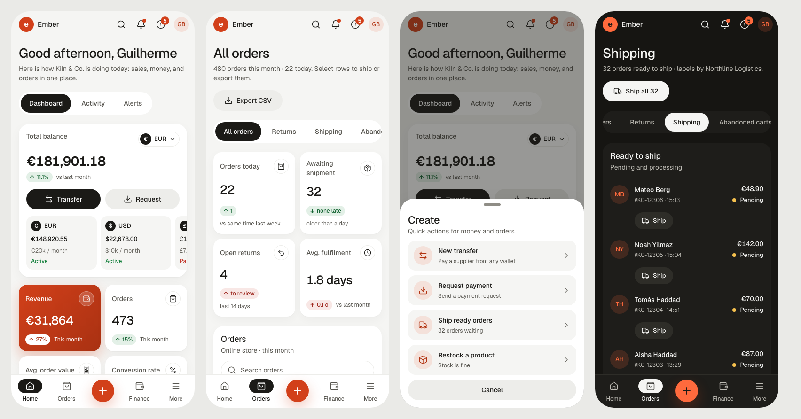
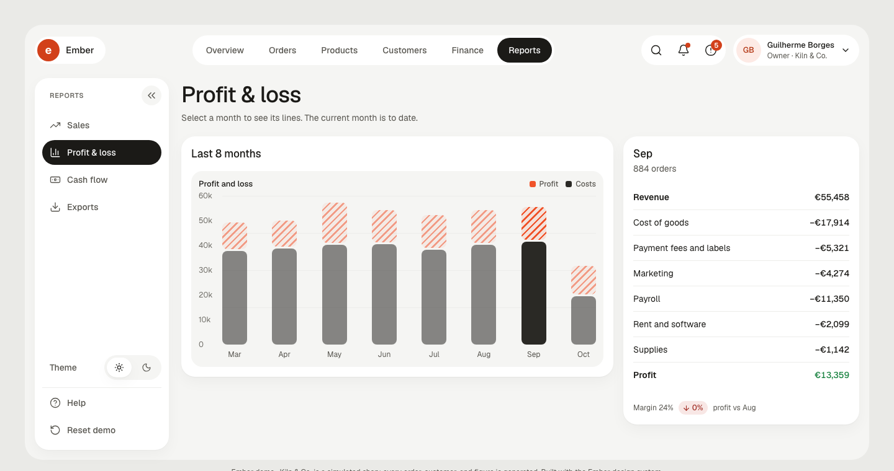
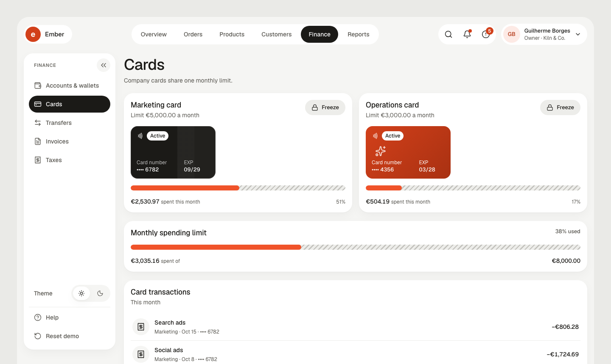

# Ember Commerce

[](https://github.com/guiboorges/ember-commerce/actions/workflows/ci.yml) [](https://github.com/guiboorges/ember-commerce/actions/workflows/pages.yml) [](https://guiboorges.github.io/ember-commerce/) [](https://github.com/guiboorges/ember-commerce/releases/latest) [](LICENSE) [](https://claude.com/claude-code)

A working business dashboard for a small online store, built with the **Ember** design system. It runs on a simulated
ceramics shop, Kiln & Co., in your browser: ship and refund orders, handle returns, restock products, move money
between wallets, freeze cards, pay supplier bills and VAT, and watch the numbers follow.

**[▶ Open the live demo](https://guiboorges.github.io/ember-commerce/)**





**On phones**, a bottom tab bar like Instagram's: Home, Orders, a **+** for quick actions, Finance, and More.



| Orders, sidebar collapsed | Profit & loss | Cards |
|---|---|---|
|  |  |  |

## Menu and submenu

The top tabs choose an area; the sidebar shows that area's pages. Every page has its own address (`#/orders/returns`),
so links and the back button work. Collapse the sidebar to icons with the « button; the choice is remembered. On phones (under 600 px) the areas move to a
bottom tab bar (Home, Orders, +, Finance, More), and the pages become a scrolling row under the title.

| Area | Pages |
|---|---|
| Overview | Dashboard, Activity, Alerts |
| Orders | All orders, Returns, Shipping, Abandoned carts |
| Products | Catalog, Inventory, Categories, Discounts |
| Customers | All customers, Segments, Reviews |
| Finance | Accounts & wallets, Cards, Transfers, Invoices, Taxes |
| Reports | Sales, Profit & loss, Cash flow, Exports |

## What works

- **Live orders:** today's orders appear as the day goes on. Select rows to ship them in bulk, open an order to ship or refund it, filter by status, search, and export CSV.
- **Returns and carts:** approve a refund (it leaves the EUR wallet and revenue) or decline it; send reminders for abandoned carts.
- **Products:** stock falls with sales and rises when you restock; low stock raises an alert. Pause or turn on discount codes.
- **Customers:** lifetime spend, segments (VIP, returning, new, at risk), and replies to reviews.
- **Finance:** one balance across EUR, USD, and GBP wallets; transfers that cannot overdraw a wallet or use the paused one; payment requests; company cards with a shared monthly limit and a freeze button; supplier bills to pay; quarterly VAT computed from sales and costs.
- **Reports:** sales by month and best sellers, profit and loss by month with every line, cash flow, and CSV exports for an accountant.
- **Everywhere:** alerts that link to the page that fixes them, notifications, search (`⌘K`), light and dark themes (following your system by default), and a reset button. Your changes are saved in the browser (`localStorage`).

> The shop is simulated. Kiln & Co., its customers, orders, and figures are generated from a seed per day, so the history is the same on every reload and for every visitor; your own actions are added on top. Nothing leaves your browser.

## The design system

Ember was designed in Figma before any code: variables for color (Light and Dark), spacing, and radius, 15 text
styles, 4 effects, a hatch texture, 21 components, 56 icons, card patterns, the navigation map, and the Overview and
Orders screens. The tokens and the generated `ember.tokens.css` live in the
[design-studio library](https://github.com/guiboorges/design-studio/tree/main/library/design-systems/ember);
`src/styles/ember.tokens.css` is a copy of that file.

- Two oranges: a bright one for charts and bars, a deeper one for buttons and text, so white text stays above 4.5:1.
- Every text role passes WCAG 2.2 AA in both themes. Statuses pair a dot with a label, and deltas pair an arrow with a value.
- The pages beyond Overview and Orders reuse the same components and patterns from the Figma library.

Icons are [Lucide](https://lucide.dev) (ISC). The typeface is [Geist](https://vercel.com/font) (OFL).

## Run it

```bash
npm install
npm run dev     # http://localhost:5173
npm test        # simulation tests
npm run build   # static site in dist/
```

React 19, TypeScript, and Vite, with no backend. The simulation is in `src/sim/`: `catalog.ts` (products, customers,
orders, returns, carts, reviews), `finance.ts` (costs, wallets, cards, bills, VAT, profit and loss), `state.ts` (every
action as a pure function), `alerts.ts`, and `useEmber.ts` (state, clock, storage). Navigation is in `src/nav.ts`, the
pages in `src/pages/`.

## License

[MIT](LICENSE) © 2026 Guilherme Borges
